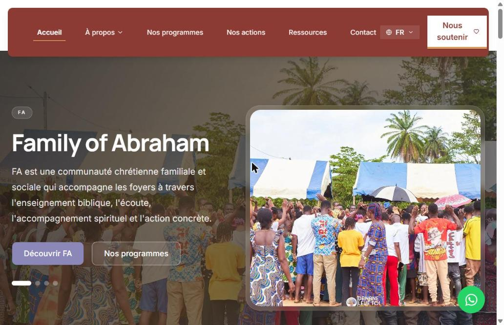
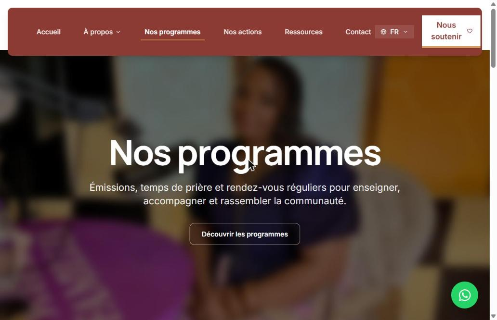
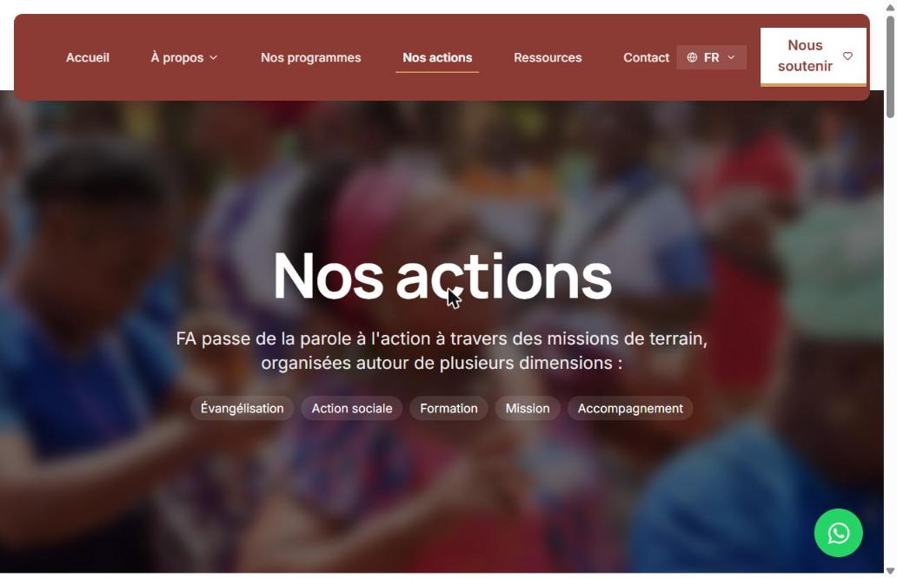

# 🤝 Family of Abraham (FA) — Site web et CMS d'une association à Londres

> Site web **bilingue (FR / EN)** de **Family of Abraham (FA)**, communauté chrétienne familiale et sociale basée à **Londres**, engagée auprès des familles au Royaume-Uni, en Europe et en Afrique. Le site s'accompagne d'un **back-office (CMS)** qui permet à l'association de gérer elle-même tout son contenu.
> **Projet client** (2026) — conception et développement de bout en bout.

🔗 **Site en ligne : [fam-site.vercel.app](https://fam-site.vercel.app/)**

> ℹ️ Dépôt vitrine : le code source appartient au client et reste privé. Cette page présente le projet, les choix techniques et mon travail.

---

## 🖼️ Aperçu

| Nos programmes | Nos actions |
|---|---|
|  |  |

## 🎯 Le besoin du client

L'association voulait un site qui :

- présente son **identité**, sa **mission** et ses valeurs ;
- met en avant ses **programmes** (message du mois, causeries de femmes, prière hebdomadaire, émissions) et ses **actions de terrain** (missions, action sociale, formation) ;
- partage ses **ressources** (vidéos YouTube, enseignements) ;
- facilite le **contact**, l'**adhésion** et le **soutien** à l'association ;
- reste **facile à mettre à jour** par l'équipe, sans passer par un développeur.

Le projet suit un **cahier des charges officiel** validé avec le client.

## ✨ Ce que fait le site

- **Site vitrine complet** : accueil, à propos (avec sous-menu : qui sommes-nous, membres de l'équipe…), programmes, actions, ressources, contact, page « Nous soutenir »
- **Deux langues (FR / EN)** avec routage par langue rendu côté serveur
- **Contenu 100 % administrable** : l'équipe modifie textes, programmes, actions, ressources, témoignages et images depuis le back-office
- **Formulaires publics** protégés contre les robots (Cloudflare Turnstile), avec envoi d'e-mails
- **Animations soignées** : défilement fluide, transitions, carrousel d'accueil, compteurs d'impact
- **Vidéos YouTube** intégrées et bouton **WhatsApp** de contact direct

## 🛠️ Stack technique

| Besoin | Outil |
|---|---|
| Framework | Next.js 16 (App Router), React 19, TypeScript |
| CMS / back-office | Payload CMS 3, intégré dans l'application Next.js |
| Base de données | PostgreSQL |
| Stockage des médias | Vercel Blob |
| Langues | next-intl (routage par langue côté serveur) |
| Interface | Tailwind CSS 4, shadcn/ui, Base UI, Lucide |
| Animations | Framer Motion, Lenis (défilement fluide) |
| E-mails | Resend |
| Anti-robot | Cloudflare Turnstile |
| Hébergement | Vercel (déploiement continu depuis GitHub) |

## 🧩 Architecture du contenu (Payload CMS)

| Type | Éléments |
|---|---|
| **Collections** | Programmes · Actions · Ressources · Témoignages · Médias · Utilisateurs |
| **Globals** (pages uniques) | Paramètres du site · Page d'accueil · Qui sommes-nous |

Chaque section du site lit son contenu dans le CMS. L'association publie un nouveau programme ou une nouvelle action sans toucher au code.

## 🔒 Sécurité

- **En-têtes HTTP de sécurité** configurés
- **Back-office déplacé** hors de l'adresse `/admin` par défaut
- Accès aux comptes administrateurs et aux **uploads** contrôlés
- **Anti-robot** Turnstile sur les formulaires publics
- Dépendances maintenues à jour (correctifs de sécurité Payload, Next.js, sharp)

## 💡 Compétences démontrées

- Relation client : cahier des charges, validation, livraison
- Développement **full-stack Next.js** avec un **CMS headless** intégré (Payload)
- Modélisation de contenu et base de données **PostgreSQL**
- Site **multilingue** avec next-intl
- **Sécurisation** d'une application web publique
- Déploiement continu sur **Vercel**

## 👤 Auteur

**Ismaël Traoré** — Développeur Data & IA
📧 contact.traoreimael@gmail.com · 💼 [LinkedIn](https://www.linkedin.com/in/ismael-traor%C3%A9-m-4007a2225/)
